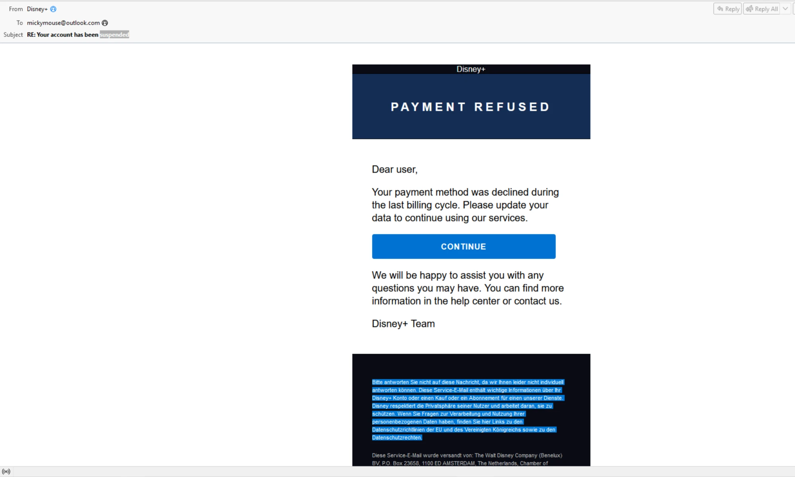
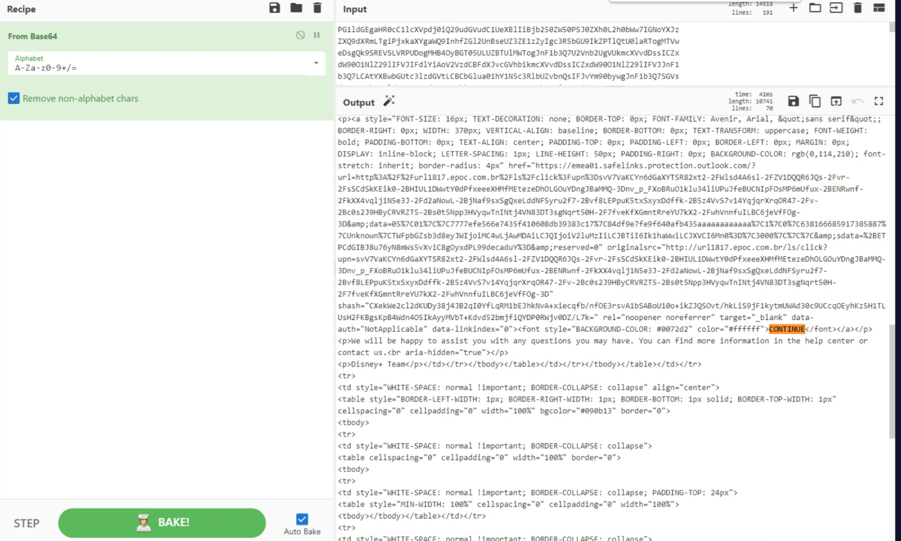
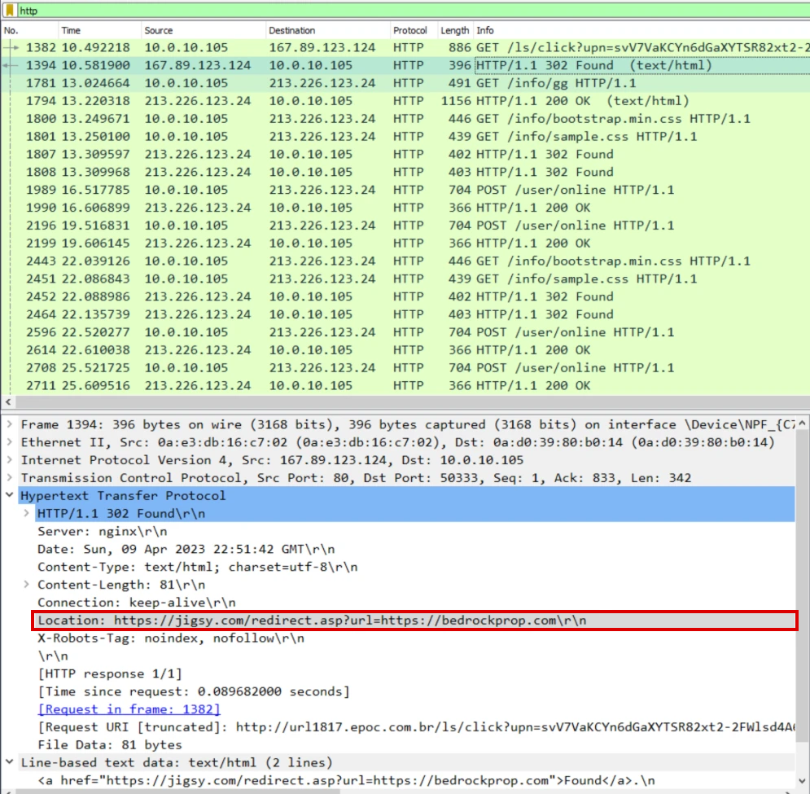
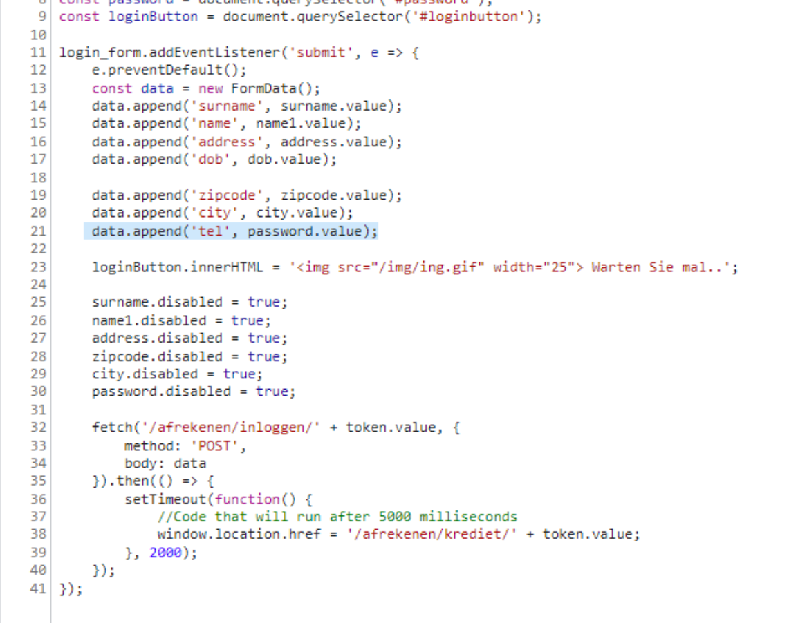
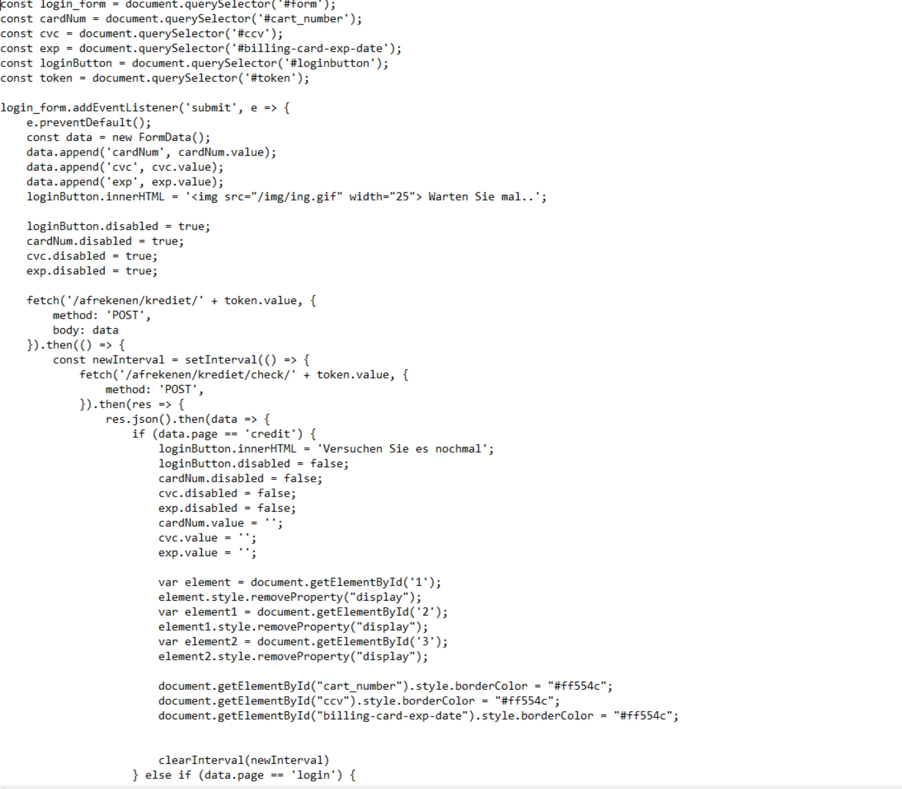
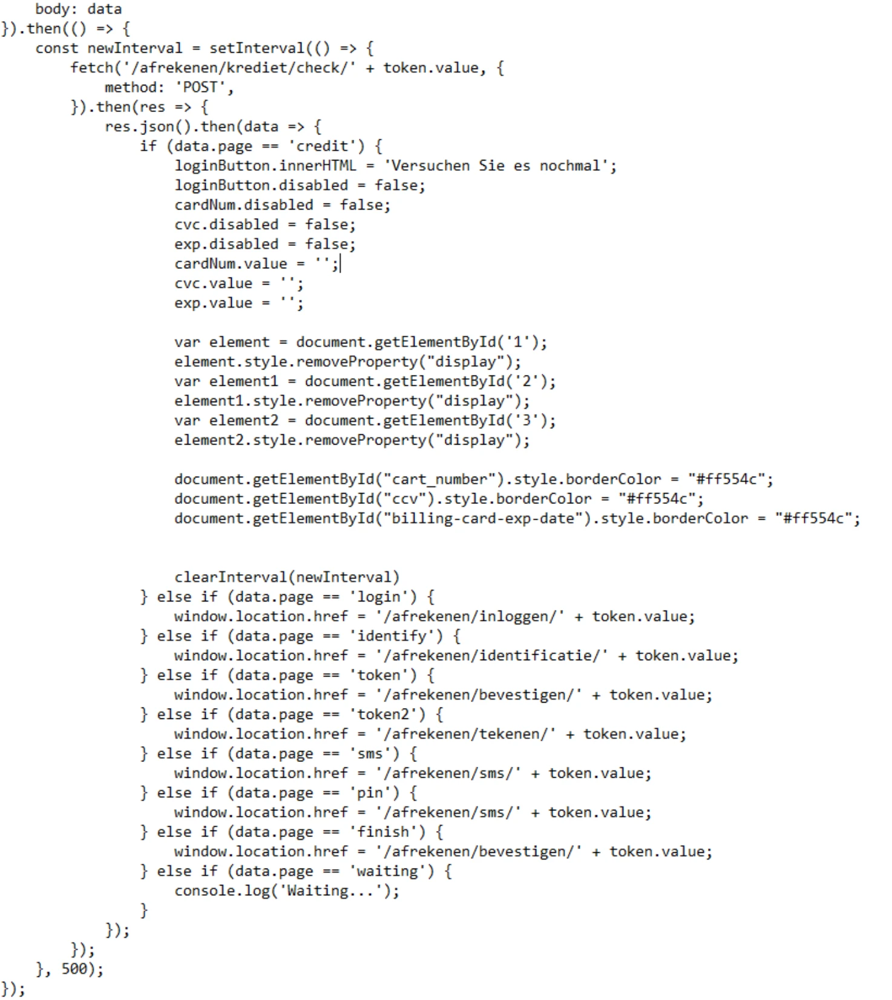
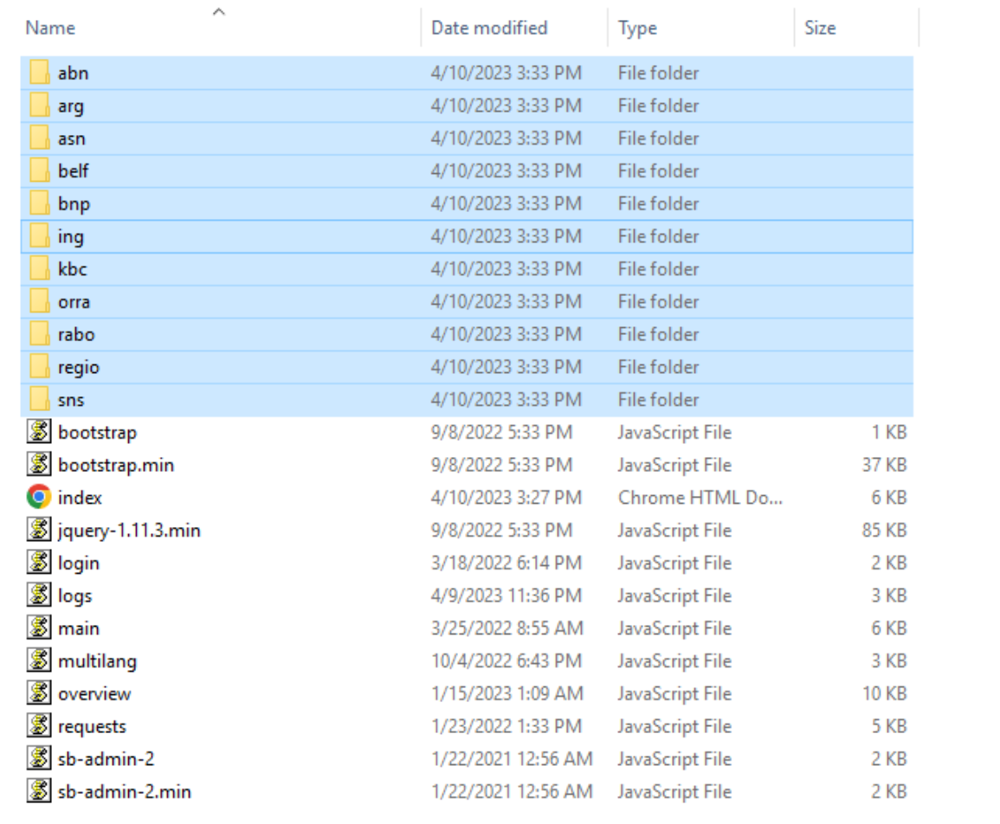

# Deep Phish: Phishing Investigation (Blue Team Labs Online)

**Platform:** Blue Team Labs Online, Security Operations, Medium (retired lab)
**Tools:** Wireshark, Chrome DevTools (HAR analysis), CyberChef, WHOIS report
**Verdict:** Phishing campaign impersonating Disney+ that harvests personal and payment-card data

> All indicators are defanged (`[.]`, `[@]`). The lab's original files are not included.

## Summary

A phishing email impersonating Disney+ sent victims through a four-hop redirect chain to a two-stage harvester. The harvester collected personal details and payment-card data, and it appears to let the operator watch victims live and decide what each one sees next, including pages that ask for SMS codes and PINs. The lure mixed English and German and most likely targeted German-speaking users, but the harvester kit was built for the Dutch-speaking market, and its server also hosted kits impersonating ten Dutch and Belgian banks. The main risks to victims are card fraud and identity fraud.

## Scenario and evidence

The lab provides:

- the phishing email (`.eml`);
- a packet capture (PCAP) of the redirect chain;
- a HAR file from a browser visit to the phishing site;
- the phishing site's files;
- a WHOIS report for the phishing domain.

## Timeline (UTC)

| Time | Event | Source |
|---|---|---|
| 2023-02-27 | `mypixar-ssl[.]com` registered | WHOIS report |
| 2023-04-09 20:23 | Email processed by Microsoft Safe Links | Timestamp inside the rewritten link |
| 2023-04-09 22:51:42 | Victim's browser requests hop 1 and gets a 302 to jigsy | PCAP |

## Analysis

### 1. The email

- **Subject:** "RE: Your account has been suspended". The fake "RE:" makes it look like part of an existing conversation.
- **Impersonation:** the sender's display name was Base64-encoded. I decoded it in CyberChef to `Disney+`.
- **Sender address:** `supp[@]agnisys[.]com`, a domain unrelated to Disney. It was probably spoofed or compromised, and nothing suggests the domain's owner was involved.
- **Lure:** a "PAYMENT REFUSED" banner and an English body saying the payment method was declined, asking the user to update their data with a **Continue** button. The button links to the first hop of a redirect chain.
- **The real link:** the email body is Base64-encoded. I decoded it in CyberChef to read the HTML behind the **Continue** button. The link is wrapped in Microsoft Safe Links (`emea01.safelinks.protection.outlook[.]com`), which the recipient's mail service adds so it can check links when they're clicked. The original target, kept in the `originalsrc` attribute, is the SendGrid tracking link `hxxp://url1817.epoc[.]com[.]br/ls/click?upn=…`. A timestamp inside the Safe Links URL decodes to 20:23 UTC on 9 April 2023, about two and a half hours before the click captured in the PCAP.
- **Footer:** in German. It's a standard "please do not reply" and privacy notice naming The Walt Disney Company (Benelux) BV in Amsterdam as the sender, probably copied from a genuine Disney+ email.

**Phishing indicators:** urgency ("suspended", "payment refused"), a generic "Dear user" greeting, a fake reply prefix, a sender domain unrelated to Disney, and a body and footer in different languages.

### 2. The redirect chain

The live link now returns **404**: the infrastructure is gone. The PCAP and HAR are the only record of what happened during the campaign. I filtered it on `http`. Hops 1 and 4 used plain HTTP, so their requests and responses are fully visible. Hops 2 and 3 used HTTPS: Wireshark shows their domain names but not their responses, because that traffic is encrypted.

| Hop | Host | Response | How it redirects |
|---|---|---|---|
| 1 | `url1817[.]epoc[.]com[.]br` | 302 Found | `Location` header pointing to jigsy |
| 2 | `hxxps://jigsy[.]com/redirect.asp?url=hxxps://bedrockprop[.]com` | Not visible (HTTPS) | Open-redirect URL on a legitimate website builder: its `url=` parameter names the next hop |
| 3 | `bedrockprop[.]com` | Not visible (HTTPS) | Unknown, because the traffic is encrypted. The next plain-HTTP request goes to the harvester |
| 4 | `mypixar-ssl[.]com` | (landing page) | Harvester |

**Hop 1 is a SendGrid click-tracking link.** The request path is `/ls/click?upn=…`, which is SendGrid's click-tracking format, and the server, `167.89.123[.]124`, is in SendGrid's registered IP range. The email was most likely sent through a SendGrid account, possibly a compromised one, with link branding for epoc.com.br. That gives the first hop the reputation of a legitimate email service. The 302 response is dated 22:51:42 GMT on 9 April 2023, the day the email was sent.

**Why use a chain?** Email filters check a link's domain reputation. The first two hops are on domains with an innocent history, and the malicious domain never appears in the email. If the harvester is taken down, the attacker can also re-point the chain without re-sending the email. In this case the recipient's mailbox used Safe Links, which checks a link when it's clicked, and a reputable first hop is designed to pass exactly that kind of check.

### 3. The harvester

I loaded the HAR file into Chrome DevTools to read `login.js`, and read the lab's copy of `credit.js`.

| Stage | Data collected |
|---|---|
| 1: landing page | Surname, name, date of birth, address, zip code, city, phone (see note below) |
| 2: card page | Card number, CVC, expiry date |

- **How the two stages connect:** `login.js` sends the personal details by POST to `/afrekenen/inloggen/` (*inloggen* = log in), together with a per-victim token. Two seconds later it sends the browser to `/afrekenen/krediet/` with the same token. The code comment says 5,000 milliseconds, but the timer is set to 2,000. The token links each victim's personal details to their card data.

- **Card stage:** `credit.js` sends the card number, CVC and expiry date by POST to `/afrekenen/krediet/` with the victim's token. It then polls `/afrekenen/krediet/check/` every half-second until the server says what should happen next.
  - If the answer is `credit`, the page shows "Versuchen Sie es nochmal" ("try again"), clears the card fields, marks them red and asks for the card details again.
  - Any other answer sends the victim to a different page:

| Answer | Page | Meaning |
|---|---|---|
| `login` | `/afrekenen/inloggen/` | Back to the personal-details stage |
| `identify` | `/afrekenen/identificatie/` | Identification |
| `token`, `finish` | `/afrekenen/bevestigen/` | Confirm |
| `token2` | `/afrekenen/tekenen/` | Sign |
| `sms`, `pin` | `/afrekenen/sms/` | SMS code or PIN |
| `waiting` | (stays on the page) | Keeps polling |

- **A live operator:** a `waiting` state, half-second polling, the heartbeat and the admin panel together suggest that the operator watches victims in real time and decides what each one sees next, for example asking for the card again if it fails. An automated card check could explain some of this, but the waiting state and the panel files point to a person.
- **Beyond card details:** the SMS, PIN, confirm and sign pages suggest the kit can also ask victims for one-time codes while the operator is acting. For example, it could capture the SMS code a bank sends to approve a card payment (3-D Secure) or a bank transaction. This shows what the kit is capable of. It doesn't show that these pages were used in this campaign.
- **Kit reuse:** the German loading message "Warten Sie mal.." is shown next to an image at `/img/ing.gif`. ING is one of the banks whose kits sit on the same server, so the Disney+ page was most likely cloned from the ING kit. The site also loads `multilang.js` and `languages.json`, which suggests the language visitors see can be switched.
- **Heartbeat:** while the page is open, it sends a POST to `/user/online` about every three seconds. This is most likely a heartbeat that shows the operator which victims are online.
- **No encryption:** despite its name, `mypixar-ssl[.]com` served the harvester over plain HTTP.
- **Phone or password?** The script reads an input with the HTML id `password` and sends its value as `tel`. It's most likely a phone field left over from a bank kit's password field. The lab provides only the JavaScript, not the page's HTML, so I couldn't confirm the label the victim saw.
- **German on screen:** the messages the victim sees on the submit button are in German: *"Warten Sie mal.."* ("wait a moment") while it loads, and *"Versuchen Sie es nochmal"* ("try again") when asked to re-enter a card.

### 4. Infrastructure

- **Domain age:** `mypixar-ssl[.]com` was registered on **2023-02-27**. The email was sent on **2023-04-09**, 41 days later. The gap suggests the infrastructure was prepared in advance. It may also have let the domain age past "newly registered domain" filters.
- **Domain name:** "mypixar" borrows Pixar, a Disney brand, and "-ssl" is there to look secure.
- **Registration:** registered through Amazon Registrar for one year only (expiring 2024-02-27), with DNS on Amazon Route 53 and WHOIS privacy from Identity Protection Service. The "GB" registrant country belongs to the privacy service, not the attacker.
- **Hosting:** two addresses in the same Russian /24 network:
  - The PCAP shows the harvester served from `213.226.123[.]24` at the time of the click.
  - The WHOIS report lists `213.226.123[.]49` (Saint Petersburg, AS49943), with four other sites on that server.

  Location shows where the server was hosted, not who the attacker is.
- **Other kits:** the server holds eleven kit folders. One, named `orra`, is the Disney+ kit. The other ten are harvesters impersonating banks in the Netherlands and Belgium:
  - Dutch: ABN AMRO, ASN Bank, ING, Rabobank, RegioBank, SNS
  - Belgian: Argenta, Belfius, BNP Paribas Fortis, KBC

- **Operator panel:** the same directory holds `sb-admin-2`, a common admin-dashboard template, alongside scripts named `overview`, `requests` and `logs`. These look like the operator's panel for watching victims and collecting their data.

## Assessment: who was targeted?

The evidence points in different directions:

- The email body is in **English**, but its footer is in **German**.
- The harvester's on-screen messages are in **German**.
- The harvester's backend paths are in **Dutch** (*afrekenen* = checkout, *krediet* = credit).
- The same server hosts kits impersonating **Dutch and Belgian banks**. Dutch is spoken in the Netherlands and in Flanders, northern Belgium.
- The Disney+ page reuses an **ING** loading image and loads a language file.

Text the victim sees has to be in the victim's language. Backend paths are never shown to the victim, so there was no reason to translate them. The harvester's on-screen messages, shown as victims submit their details, are in German, which points to German-speaking targets. The English body and the copied footer show that the lure was put together from mixed parts rather than written for one audience. The ING leftover and the language file suggest the operator cloned a Dutch bank kit and switched its visible language to German.

> **Conclusion (medium confidence):** the Disney+ lure most likely targeted German-speaking users, using a carelessly assembled email. It used a phishing kit built for the Dutch-speaking market (the Netherlands and Belgium), and the kit's server hosted ten banking scams aimed at that market. This suggests an operator reusing one kit and server across several countries and brands.

## Indicators of compromise

| Type | Indicator | Context |
|---|---|---|
| Email sender | `supp[@]agnisys[.]com` | Likely spoofed or abused sender |
| Domain | `url1817[.]epoc[.]com[.]br` | Hop 1, SendGrid click-tracking link |
| IP | `167.89.123[.]124` | Hop 1, SendGrid infrastructure. It's shared, so don't block the IP |
| URL | `hxxps://jigsy[.]com/redirect.asp?url=hxxps://bedrockprop[.]com` | Hop 2, open redirect |
| Domain | `bedrockprop[.]com` | Hop 3, likely a compromised legitimate site |
| Domain | `mypixar-ssl[.]com` | Harvester |
| IP | `213.226.123[.]24` | Served the harvester at the time of the click (PCAP) |
| IP | `213.226.123[.]49` | Harvester domain's address in the WHOIS report |
| URI path | `/afrekenen/inloggen/` | Personal-details POST endpoint |
| URI path | `/afrekenen/krediet/` | Card-data POST endpoint |
| URI path | `/afrekenen/krediet/check/` | Polled for the operator's next instruction |
| URI path | `/user/online` | Heartbeat |
| URI paths | `/afrekenen/identificatie/`, `/afrekenen/bevestigen/`, `/afrekenen/tekenen/`, `/afrekenen/sms/` | Further operator-controlled stages |

## MITRE ATT&CK mapping

| Technique | ID | Evidence |
|---|---|---|
| Phishing for Information: Spearphishing Link | T1598.003 | Email link leading to a form that collects personal and card data |
| Impersonation | T1656 | Disney+ branding and display name |
| Acquire Infrastructure: Domains | T1583.001 | `mypixar-ssl[.]com` registered 41 days before the campaign |
| Stage Capabilities: Link Target | T1608.005 | Harvester pages staged behind the redirect chain |

## Recommended response

Following the NIST incident-response lifecycle:

1. **Contain.** Block `mypixar-ssl[.]com`, `213.226.123[.]24` and `213.226.123[.]49` at the email gateway, web proxy and DNS. This also cuts off the bank kits hosted on the same server. For the abused legitimate services (the SendGrid tracking link, jigsy and bedrockprop), block the specific malicious URLs rather than whole domains or SendGrid's shared IPs.
2. **Scope.** Search the mail logs by sender, subject and link for every recipient, and remove all copies from inboxes.
3. **Identify clicks.** Check proxy and DNS logs for visits to any domain in the chain.
4. **Support victims.** Users who submitted the forms should cancel their card, contact their bank and watch for identity fraud. The data stolen (name, date of birth, address, phone) is what banks use for identity verification. As a precaution, because one field is read from an input with the id `password`, they should also change any password they might have entered. Anyone who entered an SMS code or PIN should tell their bank immediately, because the operator may have used it to approve a payment.
5. **Eradicate and report.** Report the domain for takedown to the registrar (Amazon Registrar, abuse@amazonaws.com) and to the hosting provider, report it to Disney's brand-protection team, and submit it to Google Safe Browsing. Report the abused account to SendGrid, and notify the owners of the other abused legitimate sites.
6. **Learn from it.** Add a detection rule for similar emails, share the IOCs (for example via MISP), and warn staff.

## Lessons learned

- **Captured evidence outlives infrastructure.** The live link was already dead, so the PCAP and HAR were the only way to reconstruct the attack.
- **Know what each source can show.** Hops 1 and 4 used plain HTTP and were fully visible in the PCAP. Hops 2 and 3 used HTTPS, so Wireshark showed only their domain names. At first I described all four hops as if I had seen their responses.
- **Separate what the victim sees from what only the attacker sees.** That resolved the German-versus-Dutch contradiction.